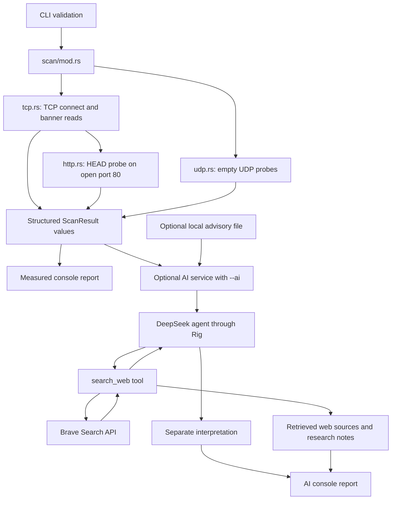

# Architecture

rmap is a Rust network scanner inspired by Nmap, with optional AI research into observed services, possible CVEs, and public exploit references. It currently scans selected ports sequentially on a single IPv4 address using TCP connect attempts or empty UDP datagrams.

## Flow through the application

`main.rs` parses CLI arguments, calls the common scan entry point, prints measured results, and then requests AI analysis if `--ai` is present. The scanner has no dependency on the AI service. AI configuration and failures cannot change measured port outcomes or prevent the initial report from being displayed.

## Module responsibilities

| Module | Responsibility |
| --- | --- |
| `src/cli/mod.rs` | Validate the IPv4 target, selected ports, positive timeout, exactly one transport flag, and optional AI flag |
| `src/cli/config.rs` | Reserved for a future typed scan configuration |
| `src/scan/mod.rs` | Dispatch TCP or UDP through one entry point |
| `src/scan/tcp.rs` | TCP connection attempts, status classification, bounded passive reads, and SSH identification |
| `src/scan/http.rs` | HTTP `HEAD` probe on open TCP port 80 and `Server` header extraction |
| `src/scan/udp.rs` | Sequential empty UDP probes, receive timeouts, and result collection |
| `src/model/mod.rs` | Shared measured results, transport and status enums, and separate AI data |
| `src/model/report.rs` | Format measured results, interpretation, research notes, and sources |
| `src/ai/config.rs` | DeepSeek and search credentials, timeout, optional local advisory path, and `.env` loading |
| `src/ai/retrieval.rs` | Optional exact product/version text matching against local advisories |
| `src/ai/web.rs` | Bounded Brave Search HTTP requests exposed as a Rig tool and capture of returned evidence |
| `src/ai/service.rs` | Research instructions, bounded scan context, model/tool orchestration, and error handling |

## Shared types

- `ScanMode` selects TCP or UDP and supplies the protocol label used in reports and AI context.
- `PortStatus` represents open, closed, tentative filtered, open or filtered, or undetermined outcomes.
- `ScanResult` records the selected port and transport, outcome, elapsed time, optional service label, error, observation, and collected banner bytes. Passive banner bytes and the reason reading stopped are stored separately; reporting generates a bounded preview without changing the stored data.
- `AiConfig` holds DeepSeek settings, a separate search key, the session timeout, and an optional local advisory path.
- `AiAnalysis` contains generated interpretation, retrieved `WebSource` values, research notes, and optional local `CveCandidate` values.
- `WebSource` holds a title, URL, and bounded snippet returned by a search request. It is evidence retrieved by the application independently of generated prose.
- `CveCandidate` holds a local advisory matched to observed product/version text and the associated port and transport.

`ScanConfig` remains planned. The CLI currently returns validated values as a tuple rather than constructing that type.

## Measured outcomes and timing

TCP elapsed time measures the initial connection attempt. Later passive reads and HTTP probes have their own waits and are excluded from that value. A refused connection is closed; a connection timeout is tentatively filtered. Successful connections remain open even when later banner collection fails. A complete supported SSH banner or valid HTTP response can supply a service label; other observations may retain an unknown service label.

UDP uses a fresh socket bound to `0.0.0.0:0` for each selected port. UDP `connect` selects the remote peer and restricts incoming datagrams without a handshake. The scanner sends an empty datagram and waits for a response. A reply is open, an OS-reported refusal is closed, and receive timeout is open or filtered. Setup and other I/O errors remain undetermined. UDP elapsed time includes setup, sending, and receiving. Empty datagrams often receive no reply from services requiring protocol-specific requests; UDP service identification is not implemented.

The report uses `/tcp` or `/udp` and an `ELAPSED` column. Both measured results and advisory candidates retain their transport throughout the AI flow.

## AI research boundaries

AI is disabled unless explicitly requested. DeepSeek receives at most eight measured outcomes, prioritizing open ports, with bounded observations or errors. A configured Brave Search key enables the model to query the public web and Exploit-DB through `search_web`. An optional local file can supplement the results; it is not required for online research.

The tool captures actual returned source links separately from the model's answer. Snippets and banners are untrusted data. The prompt requires applicability checks and citations, but model conclusions remain interpretations. A source link does not prove the model has interpreted it correctly or that a target is vulnerable.

Concurrency, host discovery, raw-packet scan methods, full service fingerprinting, and exploit execution are outside the current implementation. See [usage](usage.md), [AI integration](ai-integration.md), and the [recorded README example](../README.md#example-tcp-scan-with-ai-research).

## Tests

Unit tests for private helpers live in `tests/cli/`, `tests/scan/`, `tests/model/`, and `tests/ai/`. The source modules include those files during test builds. Tests use fixtures for request construction, response parsing, status classification, banner matching, prompt context, and formatting. No live scan, search request, or AI request is needed for these checks.
