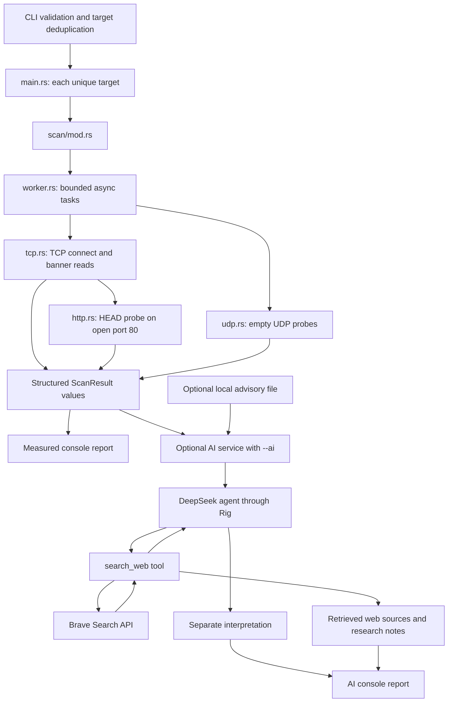

# Architecture

rmap is a Rust network scanner inspired by Nmap, with optional AI research into observed services, possible CVEs, and public exploit references. It currently scans selected ports concurrently through bounded Tokio tasks for each unique IPv4 target using TCP connect attempts or empty UDP datagrams. Hosts are processed sequentially.

## Flow through the application

`main.rs` parses CLI arguments, validates optional AI settings once, then loops over the validated target list. For each target it creates progress, calls the common scan entry point, prints measured results, and optionally requests AI interpretation for that host. The collector invokes the callback on the caller thread as probes finish, while presentation remains in `src/model/progress.rs`. AI settings are borrowed across hosts; measured results and interpretations are not combined across hosts. AI configuration failures are reported early without preventing scanning. The scanner has no dependency on the AI service. AI configuration and failures cannot change measured port outcomes or prevent the initial report from being displayed.

## Module responsibilities

| Module | Responsibility |
| --- | --- |
| `src/cli/mod.rs` | Validate input; default to TCP, ports 1–65535, 1000 ms, and 256 concurrent probes; reject conflicting transport flags |
| `src/cli/config.rs` | Validated `CliConfig` settings, including concurrency and open-only reporting selection |
| `src/scan/mod.rs` | Dispatch TCP or UDP through one entry point |
| `src/scan/worker.rs` | Schedule bounded async tasks on a shared Tokio runtime, report completions, and restore input order |
| `src/scan/tcp.rs` | TCP connection attempts, status classification, bounded passive reads, and collected-banner identification |
| `src/scan/identify.rs` | Parse supported SSH, HTTP, FTP and SMTP banners into service information |
| `src/scan/http.rs` | HTTP `HEAD` probe on open TCP port 80 and `Server` header extraction |
| `src/scan/udp.rs` | One empty UDP probe, receive timeout, and outcome classification |
| `src/model/mod.rs` | Shared measured results, transport and status enums, and separate AI data |
| `src/model/progress.rs` | Display selected port count, timeout and throttled completion progress on stderr |
| `src/model/report.rs` | Format measured results, interpretation, research notes, and sources |
| `src/mapper/service_information.rs` | Map parsed service fields into owned `ServiceInformation` values and apply them to scan results |
| `src/utils/banner.rs` | Shared CRLF line iteration, bounded byte escaping, digit-prefix checks, and banner text decoding |
| `src/ai/config.rs` | DeepSeek and search credentials, timeout, optional local advisory path, and `.env` loading |
| `src/ai/retrieval.rs` | Optional exact product/version text matching against local advisories |
| `src/ai/web.rs` | Bounded Brave Search HTTP requests exposed as a Rig tool and capture of returned evidence |
| `src/ai/service.rs` | Research instructions, bounded scan context, model/tool orchestration, and error handling |

Protocol parsers retain their format-specific rules. Shared byte operations live in utility functions, and model construction lives in mapper functions. SSH, HTTP, FTP and SMTP reuse the same service mapper; TCP banner previews, UDP response previews and HTTP header previews reuse the same byte-escaping helper. AI context and local advisory matching reuse the same banner-text decoder. These modules use ordinary Rust functions and do not add dependencies.

## Shared types

- `ScanMode` selects TCP or UDP and supplies the protocol label used in reports and AI context. Omitted transport flags default to TCP.
- `PortStatus` represents open, closed, tentative filtered, open or filtered, or undetermined outcomes.
- `ServiceInformation` stores the identified protocol label, transport, optional product and version, and optional banner comments. Banner comments are separate from the read stop reason in `ScanResult.observation`.
- `ScanResult` records the selected port and transport, outcome, elapsed time, optional service label, error, observation, and collected banner bytes. Passive banner bytes and the reason reading stopped are stored separately; reporting generates a bounded preview without changing the stored data.
- `AiConfig` holds DeepSeek settings, a separate search key, the session timeout, and an optional local advisory path.
- `AiAnalysis` contains generated interpretation, retrieved `WebSource` values, research notes, and optional local `CveCandidate` values.
- `WebSource` holds a title, URL, and bounded snippet returned by a search request. It is evidence retrieved by the application independently of generated prose.
- `CveCandidate` holds a local advisory matched to observed product/version text and the associated port and transport.

`CliConfig` in `src/cli/config.rs` holds a validated target vector, ports, timeout, transport, concurrency, open-only display selection, and the AI enable flag. AI connection settings remain separate in `AiConfig`.

`parsing_target_list` validates each comma-separated entry as an `Ipv4Addr`. A standard-library `HashSet` tracks membership while the output vector preserves first-occurrence order. Duplicate targets are omitted before scanning, so they receive one scan/report and at most one optional AI session each. Empty and invalid entries still fail validation, including when they follow duplicate entries. The scanner entry point continues to handle one host at a time. CIDR expansion and concurrent host scheduling are not implemented.

CLI port selection and exclusions share `parsing_ports_function` in `src/cli/mod.rs`. It accepts comma-separated individual ports and inclusive ranges, validates nonzero `u16` endpoints and ascending bounds, then expands them to the configuration's port strings. Expansion preserves order and duplicates. `--exclude-ports` requires an earlier explicit `--ports` list and removes matching entries without changing the order of remaining ports. Exclusions cannot remove every selected port. Range parsing and exclusion behavior are tested without network calls.

## Concurrent scheduling

The common entry point validates all targets, creates one current-thread Tokio runtime, and runs asynchronous probes through a `JoinSet`. The scheduler fills available slots, waits for a completion, then schedules more work. It never creates a task for every port at once. The default limit is 256 active probes; `--concurrency` accepts 1–1024 and is capped by the selected port count. A limit of 1 runs sequentially. TCP and UDP each expose an asynchronous single-port probe, independent of scheduling and AI.

TCP connect and banner collection use Tokio sockets and deadlines. UDP uses a Tokio socket and bounded send/receive waits. The HTTP probe is awaited in the same runtime, without creating a nested runtime. Network waits yield to other tasks rather than occupying one OS thread per probe. Tokio was already a dependency; its networking, I/O and synchronization features are explicitly enabled.

The collector invokes progress callbacks on the caller thread in task completion order, then assembles the final vector in requested order, including duplicate ports. Task IDs track each port so a task panic becomes an undetermined result without discarding other measurements. Dropping the task set cancels unfinished work.

Reporting filters to confirmed open ports when `--ports` was omitted or contains at least one range. Explicit lists of individual ports retain all rows. `CliConfig.open_only` selects this presentation mode; exclusion ranges alone do not enable it. Empty open-port reports have an explicit message. The result vector stays intact, and AI still receives bounded context selected from all measured outcomes.

## Measured outcomes and timing

Passive TCP banner reads continue across short reads until the newline, byte limit, timeout or connection close; the number of read calls does not determine the byte limit. TCP elapsed time measures the initial connection attempt. Later passive reads and HTTP probes have their own waits and are excluded from that value. A refused connection is closed; a connection timeout is tentatively filtered. Successful connections remain open even when later banner collection fails. After a TCP result is assembled, the identification module examines its preserved banner. Complete supported SSH identification lines supply an `ssh` label, and the `OpenSSH_` software identifier supplies the product and version. Optional comments preserve distribution information. The extracted fields also enter AI context. Unknown SSH implementations retain a protocol label without guessed product/version fields. A valid HTTP probe response supplies an `http` label; other observations may retain an unknown service label.

Identification tries SSH, HTTP, FTP, then SMTP. Every parser uses `complete_lines` for CRLF-terminated lines and `map_tcp_service` to construct identification data. `starts_with_digit` supplies the shared version-prefix check. `collect_banner` applies identification through `apply_service_information`, preserving the port state, elapsed time, raw banner bytes, and read stop reason.

The SMTP parser first checks for an exact uppercase `SMTP` or `ESMTP` whitespace token, then requires a `220 ` or `220-` greeting prefix. It searches the remaining tokens for `Postfix` or `Exim`; the immediately following token is retained as a version only when it starts with an ASCII digit and contains ASCII alphanumeric characters, dots, hyphens, or underscores. Product and version are optional, so an unknown implementation still receives an `smtp` label. The same logic applies on nonstandard ports and is covered by in-memory fixtures.

SMTP identification is passive. There is no `EHLO`, `STARTTLS`, implicit TLS handling, slash-style product/version parsing, or complete multiline greeting collection. Passive reads stop at a newline, so later greeting lines are not guaranteed to be available. Structured SMTP fields enter the existing AI context when that result is selected within the observation limit; identifying SMTP does not itself trigger any AI request.

UDP uses a fresh socket bound to `0.0.0.0:0` for each selected port. UDP `connect` selects the remote peer and restricts incoming datagrams without a handshake. The scanner sends an empty datagram and waits for a response. A reply is open, an OS-reported refusal is closed, and receive timeout is open or filtered. Setup and other I/O errors remain undetermined. UDP elapsed time includes setup, sending, and receiving. Empty datagrams often receive no reply from services requiring protocol-specific requests; UDP service identification is not implemented.

The report uses `/tcp` or `/udp` and an `ELAPSED` column. Both measured results and advisory candidates retain their transport throughout the AI flow.

## AI research boundaries

AI is disabled unless explicitly requested. DeepSeek receives at most eight measured outcomes, prioritizing open ports, with bounded observations or errors. A configured Brave Search key enables the model to query the public web and Exploit-DB through `search_web`. An optional local file can supplement the results; it is not required for online research.

The tool captures actual returned source links separately from the model's answer. Snippets and banners are untrusted data. The prompt requires applicability checks and citations, but model conclusions remain interpretations. A source link does not prove the model has interpreted it correctly or that a target is vulnerable.

Host discovery, raw-packet scan methods, full service fingerprinting, and exploit execution are outside the current implementation. See [usage](usage.md), [AI integration](ai-integration.md), and the [recorded README example](../README.md#example-tcp-scan-with-ai-research).

## Tests

Unit tests for private helpers live in `tests/cli/`, `tests/scan/`, `tests/model/`, and `tests/ai/`. The source modules include those files during test builds. Tests use fixtures for request construction, response parsing, status classification, banner matching, prompt context, formatting, and concurrent scheduling. Worker tests use fake probes to verify overlap, concurrency limits, completion notifications, and ordered results. No live scan, search request, or AI request is needed for these checks.

SSH identification parsing follows the line format documented in [RFC 4253, section 4.2](https://www.rfc-editor.org/rfc/rfc4253#section-4.2). The current parser requires a complete CRLF-terminated line and limits identification lines to 255 bytes. Protocol version (`2.0` or compatibility identifier `1.99`) is kept distinct from an OpenSSH software version such as `10.0p2`.
