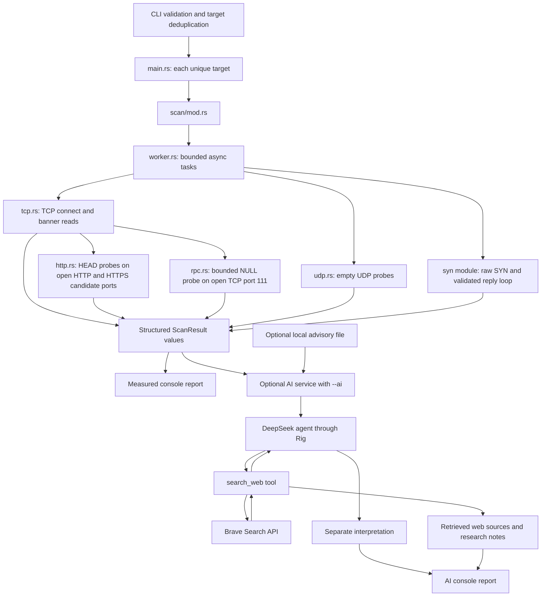

# Architecture

Version **0.5.2** connects bounded TCP portmapper v2 identification to the scanner
alongside HTTP/HTTPS probing and passive SSH, FTP, and SMTP recognition. The
IPv4 SYN pipeline continues to perform port discovery without application
identification.

rmap is also the author's research project in networking and cybersecurity.
The current architecture separates measurements, protocol identification, and
optional AI interpretation. Planned assessment context, connectivity-policy
evaluation, and cross-run comparison will build on these boundaries; they are
not implemented in this release. See [research direction](research.md).

rmap is a Rust network scanner inspired by Nmap, with optional AI research into observed services, possible CVEs, and public exploit references. It scans selected ports concurrently through bounded Tokio tasks for each unique IPv4 target using TCP connect, raw TCP SYN, or empty UDP probes. Hosts are processed sequentially.

## Flow through the application

`main.rs` parses CLI arguments, validates optional AI settings once, then loops over the validated target list. For each target it creates progress, calls the common scan entry point, prints measured results, and optionally requests AI interpretation for that host. The collector invokes the callback on the caller thread as probes finish, while presentation remains in `src/model/progress.rs`. AI settings are borrowed across hosts; measured results and interpretations are not combined across hosts. AI configuration failures are reported early without preventing scanning. The scanner has no dependency on the AI service. AI configuration and failures cannot change measured port outcomes or prevent the initial report from being displayed.

## Module responsibilities

| Module | Responsibility |
| --- | --- |
| `src/cli/mod.rs` | Validate input; default to TCP, ports 1–65535, 1000 ms, and 256 concurrent probes; reject conflicting transport flags |
| `src/cli/config.rs` | Validated `CliConfig` settings, including concurrency and open-only reporting selection |
| `src/scan/mod.rs` | Dispatch TCP connect, SYN, or UDP through one entry point |
| `src/scan/syn/mod.rs` | Prepare and own probe resources; send and orchestrate response handling |
| `src/scan/syn/packet.rs` | Pure byte construction, IPv4/TCP parsing, and checksums |
| `src/scan/syn/reply.rs` | Match, classify, handle deadlines, and preserve results on cleanup failure |
| `src/scan/syn/socket.rs` | Source selection, socket setup/registration, shared readiness waits, and packet I/O |
| `src/model/syn.rs` | Parsed packet, reply, and original-probe values |
| `src/mapper/syn.rs` | Map SYN measurements into TCP results |
| `src/scan/worker.rs` | Schedule bounded async tasks on a shared Tokio runtime, report completions, and restore input order |
| `src/scan/tcp.rs` | TCP connection measurements, HTTP/HTTPS/RPC dispatch, bounded passive reads, and result-preserving identification |
| `src/scan/identify.rs` | Parse supported SSH, HTTP, FTP and SMTP banners into service information |
| `src/scan/http.rs` | HTTP/HTTPS candidate and request selection, bounded `HEAD` probes, and structured `Server` header extraction |
| `src/scan/rpc.rs` | Bounded TCP portmapper NULL exchange, record encoding/assembly, reply validation, candidate selection, and validated-response mapping |
| `src/scan/udp.rs` | One empty UDP probe, receive timeout, and outcome classification |
| `src/model/mod.rs` | Shared measured results, transport and status enums, and separate AI data |
| `src/model/rpc.rs` | Advertised program/version/protocol/port mappings, distinct from measured connectivity |
| `src/model/progress.rs` | Display selected port count, timeout and throttled completion progress on stderr |
| `src/model/report.rs` | Format measured results, interpretation, research notes, and sources |
| `src/mapper/service_information.rs` | Map parsed service fields into owned `ServiceInformation` values and apply them to scan results |
| `src/utils/banner.rs` | Shared CRLF line iteration, bounded byte escaping, digit-prefix checks, and banner text decoding |
| `src/ai/config.rs` | DeepSeek and search credentials, timeout, optional local advisory path, and `.env` loading |
| `src/ai/retrieval.rs` | Optional exact product/version text matching against local advisories |
| `src/ai/web.rs` | Bounded Brave Search HTTP requests exposed as a Rig tool and capture of returned evidence |
| `src/ai/service.rs` | Research instructions, bounded scan context, model/tool orchestration, and error handling |

Protocol parsers retain their format-specific rules. Shared byte operations live in utility functions, and model construction lives in mapper functions. SSH, HTTP, FTP, SMTP, and RPC reuse the same service mapper; TCP banner previews, UDP response previews and HTTP header previews reuse the same byte-escaping helper. AI context and local advisory matching reuse the same banner-text decoder. These modules use ordinary Rust functions and do not add dependencies.

## Shared types

- `ScanMode` selects TCP connect, SYN, or UDP. Its transport mapping labels SYN results as TCP. Omitted mode flags default to TCP connect.
- `PortStatus` represents open, closed, tentative filtered, open or filtered, or undetermined outcomes.
- `ServiceInformation` stores the identified protocol label, transport, optional product and version, and optional banner comments. Banner comments are separate from the read stop reason in `ScanResult.observation`.
- `ScanResult` records the selected port and transport, outcome, elapsed time, optional service label, error, observation, and collected banner bytes. Passive banner bytes and the reason reading stopped are stored separately; reporting generates a bounded preview without changing the stored data. Its optional `rpc_mappings` field holds advertised registrations from successful DUMP enumeration separately from those measurements.
- `RpcMapping` retains four unsigned wire values: RPC program, program version, IP transport protocol, and port. Its program version is not a software release version, and its advertised endpoint is not a new measured open port.
- `AiConfig` holds DeepSeek settings, a separate search key, the session timeout, and an optional local advisory path.
- `AiAnalysis` contains generated interpretation, retrieved `WebSource` values, research notes, and optional local `CveCandidate` values.
- `WebSource` holds a title, URL, and bounded snippet returned by a search request. It is evidence retrieved by the application independently of generated prose.
- `CveCandidate` holds a local advisory matched to observed product/version text and the associated port and transport.

`CliConfig` in `src/cli/config.rs` holds a validated target vector, ports, timeout, transport, concurrency, open-only display selection, and the AI enable flag. AI connection settings remain separate in `AiConfig`.

## Target selection and CIDR expansion

`parsing_target_list` accepts comma-separated IPv4 addresses and CIDR subnets. CIDR entries call `parsing_target_for_subnet` to validate the address and prefix, then `calculate_subnet_boundaries` to obtain network and broadcast boundaries. The validated prefix is always from 0 through 32 before the boundary helper is called. A standard-library `HashSet` tracks membership while the output vector preserves first-occurrence order. Duplicate targets are omitted before scanning, so they receive one scan/report and at most one optional AI session each. Empty and invalid entries still fail validation, including when they follow duplicate entries.

The scanner entry point continues to handle one host at a time. For prefixes below 31, expansion excludes network and broadcast boundaries; `/31` and `/32` retain all endpoints. Counts use `u64` to avoid `/0` overflow, and each subnet is checked against `MAX_TARGETS` (4,096) before iteration. The same maximum is enforced across unique entries from the combined list; overlaps and duplicates do not consume extra slots. Expansion is completed and validated before the existing host loop starts. Concurrent host scheduling and host discovery are not implemented.

CLI port selection and exclusions share `parsing_ports_function` in `src/cli/mod.rs`. It accepts comma-separated individual ports and inclusive ranges, validates nonzero `u16` endpoints and ascending bounds, then expands them to the configuration's port strings. Expansion preserves order and duplicates. `--exclude-ports` requires an earlier explicit `--ports` list and removes matching entries without changing the order of remaining ports. Exclusions cannot remove every selected port. Range parsing and exclusion behavior are tested without network calls.

## Concurrent scheduling

The common entry point validates all targets, creates one current-thread Tokio runtime, and runs asynchronous probes through a `JoinSet`. The scheduler fills available slots, waits for a completion, then schedules more work. It never creates a task for every port at once. The default limit is 256 active probes; `--concurrency` accepts 1–1024 and is capped by the selected port count. A limit of 1 runs sequentially. TCP and UDP each expose an asynchronous single-port probe, independent of scheduling and AI.

`src/scan/resources.rs` also caps active probes using Linux's soft open-file limit
from `/proc/self/limits` and current usage from `/proc/self/fd`. It runs after
runtime creation to include reactor descriptors. It subtracts current usage and
32 descriptors of headroom, then divides the remainder by two for SYN or one
for TCP/UDP. SYN holds both a source-port reservation and a raw socket; TCP drops
the initial stream before opening its separate HTTP connection. The smaller of this budget and the
requested concurrency reaches the worker. A reduction is reported on stderr;
no selected ports are removed. An exhausted budget is a scan-level error. If
`/proc` cannot be inspected, the requested bound remains in effect.

The budget is a starting snapshot, not a reservation of operating-system
resources. Later local failures still produce undetermined outcomes and are
summarized in open-only reports. This guard does not implement network pacing,
adaptive timeouts, or retries, and cannot guarantee parity with another scanner.

TCP connect and banner collection use Tokio sockets and deadlines. UDP uses a Tokio socket and bounded send/receive waits. The HTTP probe is awaited in the same runtime, without creating a nested runtime. Network waits yield to other tasks rather than occupying one OS thread per probe. Tokio was already a dependency; its networking, I/O and synchronization features are explicitly enabled.

The collector invokes progress callbacks on the caller thread in task completion order, then assembles the final vector in requested order, including duplicate ports. Task IDs track each port so a task panic becomes an undetermined result without discarding other measurements. Dropping the task set cancels unfinished work.

Reporting filters to confirmed open ports when `--ports` was omitted or contains at least one range. Explicit lists of individual ports retain all rows. `CliConfig.open_only` selects this presentation mode; exclusion ranges alone do not enable it. Empty open-port reports have an explicit message. The result vector stays intact, and AI still receives bounded context selected from all measured outcomes.

## Measured outcomes and timing

Passive TCP banner reads continue across short reads until the newline, byte limit, timeout or connection close; the number of read calls does not determine the byte limit. TCP elapsed time measures the initial connection attempt. Later passive reads and HTTP probes have their own waits and are excluded from that value. A refused connection is closed; a connection timeout is tentatively filtered. Successful connections remain open even when later banner collection fails. After a TCP result is assembled, the identification module examines its preserved banner. Complete supported SSH identification lines supply an `ssh` label, and the `OpenSSH_` software identifier supplies the product and version. Optional comments preserve distribution information. The extracted fields also enter AI context. Unknown SSH implementations retain a protocol label without guessed product/version fields. A valid HTTP probe response supplies an `http` label; other observations may retain an unknown service label.

Passive identification tries SSH, HTTP, FTP, then SMTP. Passive parsers use `complete_lines` for CRLF-terminated lines; service identification uses `map_tcp_service` to construct its model. `starts_with_digit` supplies the shared version-prefix check. `collect_banner` applies identification through `apply_service_information`, preserving the port state, elapsed time, raw banner bytes, and read stop reason.

TCP automatically selects a separate HTTP `HEAD` probe for confirmed-open ports
80, 8000, 8080, and 8888, or an HTTPS probe for 443 and 8443. `probe_request`
selects the scheme before execution. The probe records that scheme before moving
the request into `client.execute`, and propagates errors before identification.
`http::response_information` passes the original `Server`
header to `identify_http_server` before making the escaped 64-byte console
preview. The parser accepts one product or product/version, optionally followed
by a simple parenthesized comment. `split_http_comment` separates the comment;
`is_http_component` validates the product and version. Unsupported formats retain
the protocol label without guessing software fields. Missing or undecodable headers
also leave software fields unknown.

After successful execution, `response_information` labels HTTPS based on the
request scheme and keeps TCP as the transport. It is also the fixture boundary
used by offline tests. Default certificate trust and name verification remain
enabled; there is no TLS bypass or automatic plaintext fallback. These tests do
not run TLS handshakes or establish live certificate-validation behavior.

`http::probe` returns structured identification and the display observation.
`tcp::apply_http_probe_result` applies that identification through the existing
mapper and stores the observation, preserving the measured state and connection
time. Probe errors become observations on the already-open result. This flow
does not add application probing to SYN mode or infer an OS from comments.

RPC has a separate completed-response integration boundary. `is_rpc_candidate`
selects TCP port 111 as an initial hint. `response_information` validates a fully
reassembled reply body against the original XID, then calls
`map_portmapper_service` in the existing service mapper. The resulting `rpcbind`
label records program 100000, protocol version 2, and NULL procedure success as
observations. Product and software version remain unknown.

`tcp::apply_rpc_probe_result` accepts a completed exchange result only for an
open TCP-connect candidate. Successful identification uses
`apply_service_information`; diagnostics are appended to existing observations.
Connection state, elapsed time, socket error, and passive bytes are preserved.
Failure also retains any previous service identification. Tests supply fixture
replies and exchange errors at this boundary; they do not open sockets.
`scan_port` now selects this path for confirmed-open TCP port 111, closing its
initial stream before `collect_rpc` starts a separate exchange. This preserves
the descriptor budget of one TCP connection per active task. `collect_rpc`
uses `run_rpc_exchange` to generate an XID with the existing `getrandom`
dependency, compute an absolute deadline from the configured timeout, and invoke
`rpc::probe` with a 4096-byte assembled-reply limit. The original XID reaches the
result handler for matching. An XID-generation error becomes an identification
diagnostic without sending a request or changing the open state.

The exchange connects, sends the complete framed NULL call, and assembles reply
fragments under that shared deadline. Each fragment's total size is checked
before allocation. The deadline is also checked each iteration to bound empty
fragments. TCP elapsed time still measures only the initial connection attempt;
identification has its own timeout budget. UDP and SYN do not enter this path.
Tests inject exchanges into `collect_rpc` and use in-memory streams for record
reading; no test here validates a live RPC server. NFS identification and RPC on
other ports remain outside the initial scope. See
[RPC learning notes](rpc-identification.md).

The common `build_portmapper_call` encodes the argument-free request header for
NULL and DUMP, varying only the procedure number. Both wrappers return byte
vectors directly. `validate_rpc_success_reply` validates the common envelope
and returns the result-body offset. NULL then requires no remaining payload;
the DUMP parser reads its list from that offset.

Both probe wrappers reuse `exchange_rpc_call` and `exchange_rpc_stream`; the
latter permits in-memory request/response tests without sockets. After NULL
identifies portmapper, `scan_port` calls `collect_rpc_dump`, which uses
`run_rpc_exchange` with `rpc::probe_dump`. This is a fresh connection, XID, and
timeout budget; NULL's connection is already closed. Both exchanges share the
4096-byte reply bound. DUMP parsing additionally enforces `MAX_DUMP_ENTRIES`
(128) before adding another registration. `apply_rpc_dump_result` stores the
parsed list and preserves NULL identification and measured state on enumeration
failure. Repeated observation handling uses `append_observation` rather than
replacing evidence.

`ScanResult.rpc_mappings` uses `None` for no successful enumeration and
`Some(Vec::new())` for a successful empty result. The report renders populated
data as a separate advertised-registration table, using TCP/UDP labels or the
raw IP protocol number when unknown. These rows do not affect scan counts or
the open-port summary. The list parser validates markers, entry limits, truncation,
and trailing bytes. Runtime enumeration only follows successful NULL
identification on an open TCP port 111; no extra endpoint is probed based on a
registration. UDP and SYN never call the enumeration helper.

The SMTP parser first checks for an exact uppercase `SMTP` or `ESMTP` whitespace token, then requires a `220 ` or `220-` greeting prefix. It searches the remaining tokens for `Postfix` or `Exim`; the immediately following token is retained as a version only when it starts with an ASCII digit and contains ASCII alphanumeric characters, dots, hyphens, or underscores. Product and version are optional, so an unknown implementation still receives an `smtp` label. The same logic applies on nonstandard ports and is covered by in-memory fixtures.

SMTP identification is passive. There is no `EHLO`, `STARTTLS`, implicit TLS handling, slash-style product/version parsing, or complete multiline greeting collection. Passive reads stop at a newline, so later greeting lines are not guaranteed to be available. Structured SMTP fields enter the existing AI context when that result is selected within the observation limit; identifying SMTP does not itself trigger any AI request.

UDP uses a fresh socket bound to `0.0.0.0:0` for each selected port. UDP `connect` selects the remote peer and restricts incoming datagrams without a handshake. The scanner sends an empty datagram and waits for a response. A reply is open, an OS-reported refusal is closed, and receive timeout is open or filtered. Setup and other I/O errors remain undetermined. UDP elapsed time includes setup, sending, and receiving. Empty datagrams often receive no reply from services requiring protocol-specific requests; UDP service identification is not implemented.

The report uses `/tcp` or `/udp` and an `ELAPSED` column. Both measured results and advisory candidates retain their transport throughout the AI flow.

## AI research boundaries

AI is disabled unless explicitly requested. DeepSeek receives at most eight measured outcomes, prioritizing open ports, with bounded observations or errors. A configured Brave Search key enables the model to query the public web and Exploit-DB through `search_web`. An optional local file can supplement the results; it is not required for online research.

The tool captures actual returned source links separately from the model's answer. Snippets and banners are untrusted data. The prompt requires applicability checks and citations, but model conclusions remain interpretations. A source link does not prove the model has interpreted it correctly or that a target is vulnerable.

## SYN response processing

CLI parsing treats `--syn` as a TCP technique modifier: it works alone or with
`--tcp`; combining it with `--udp` is invalid. The common entry point checks
raw-socket availability before scheduling probes. This preflight creates and
closes a local raw socket without sending packets. Local failures during later
probes remain visible through an undetermined count and sample error even when
individual non-open rows are hidden.

`scan_port` retains the TCP source-port reservation, sequence number, and endpoints
in a `SynProbe`, and registers a nonblocking raw TCP socket with Tokio before
sending. `finish_syn_probe` receives packets under the original deadline and
passes each through IPv4 parsing, TCP checksum/length validation, endpoint and
ACK matching, and flag classification. Invalid or unrelated packets are ignored;
the loop yields to other tasks and never extends the deadline.

The flow accepts ACK-bearing SYN/ACK as open and RST/ACK as closed. Silence is
tentatively filtered; local setup, send, and receive failures remain unknown.
Open results invoke reset cleanup with a cap of 100 ms within the remaining
probe budget. A cleanup failure is recorded as an observation and does not
discard the open state. Elapsed time is recorded before cleanup.

`finish_syn_probe` accepts small receive/cleanup callbacks so offline tests can
inject complete packets, silence, and failures without raw privileges. The real
callbacks use the socket readiness helpers. Raw behavior has not been live-tested;
ICMP error interpretation, IPv6 SYN, retransmissions, and application probes in
SYN mode are outside this implementation. Per-probe raw sockets and memory use
still need evaluation before high-concurrency production use.

The parsed peer TCP sequence number is retained for diagnostics and parser
tests. It has a field-level dead-code allowance because production matching
and cleanup currently use the acknowledgment number instead. The entire SYN
model module is no longer exempt from dead-code checking.

Host discovery, other raw-packet scan methods, full service fingerprinting, and
exploit execution remain outside the current implementation. See [usage](usage.md),
[AI integration](ai-integration.md), and the [SYN learning guide](syn-learning-guide.md).

## Tests

Unit tests for private helpers live in `tests/cli/`, `tests/scan/`, `tests/model/`, and `tests/ai/`. The source modules include those files during test builds. Tests use fixtures for request construction, response parsing, status classification, banner matching, prompt context, formatting, and concurrent scheduling. Worker tests use fake probes to verify overlap, concurrency limits, completion notifications, and ordered results. No live scan, search request, or AI request is needed for these checks.

Resource tests distinguish soft from hard descriptor limits, cover exhausted
budgets without unsigned underflow, and simulate a full 65,535-port schedule with
a reduced budget. They verify that ports throughout the range are retained and
that the worker respects the effective concurrency, without opening sockets.

SSH identification parsing follows the line format documented in [RFC 4253, section 4.2](https://www.rfc-editor.org/rfc/rfc4253#section-4.2). The current parser requires a complete CRLF-terminated line and limits identification lines to 255 bytes. Protocol version (`2.0` or compatibility identifier `1.99`) is kept distinct from an OpenSSH software version such as `10.0p2`.
